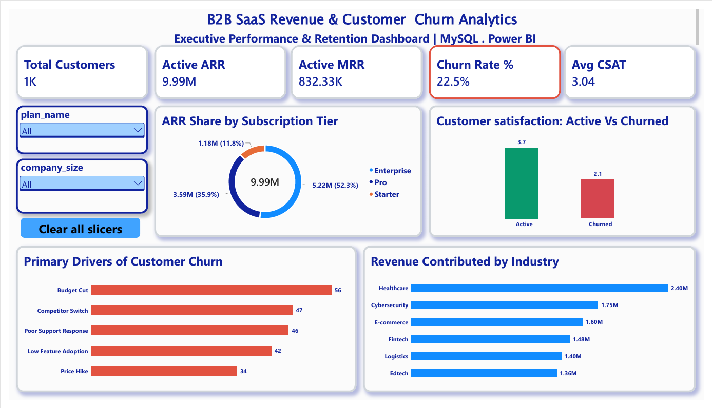

# B2B SaaS Customer Health & Revenue Leakage Analytics

An enterprise end-to-end data analytics project combining **MySQL (Data Modeling & Cohort Logic)**, **Power BI (Executive Retention Dashboard)**, and **Python / Google Gemini (GenAI Customer Health Copilot)** to diagnose ARR churn drivers and automate account retention workflows.

---

## Executive Summary & Key Metrics
- **Active ARR Managed:** $9.99M across Enterprise, Pro, and Starter tiers.
- **Account Churn Rate:** 22.5% (Target: <15%).
- **Average CSAT Score:** 3.04 / 5.0 (Active: 3.7 vs Churned: 2.1).
- **Core Churn Driver:** Unresolved high-priority support tickets and budget realignments.

---

## Data Architecture & Relational Schema
The project utilizes a 4-table Star Schema implemented in MySQL:
- **Dim_Companies:** Firmographic attributes (`company_id`, `company_name`, `industry`, `company_size`).
- **Dim_Subscriptions:** Contract economics (`subscription_id`, `plan_name`, `start_date`, `arr`, `mrr`, `churn_status`, `churn_reason`).
- **Fact_DailyUsage:** Engagement telemetry (`usage_date`, `daily_active_users`, `feature_clicks`).
- **Fact_SupportTickets:** Service health tracking (`ticket_id`, `priority`, `resolution_time_hrs`, `csat_score`).

---

## Power BI Executive Dashboard

### Key Features Built:
- **Executive KPI Cards:** Real-time visibility into Total Customers, Active ARR, Active MRR, Churn Rate %, and Average CSAT.
- **ARR Distribution by Plan:** Visual breakdown showing Enterprise (52.3%), Pro (35.9%), and Starter tiers.
- **Root Cause Churn Breakdown:** Pareto analysis identifying revenue loss drivers.
- **Interactive Multi-Slicing:** Tier, Industry, and Status filtering with native Clear All Slicers action control.

---

## SQL Analytical Queries
Located in `sql/business_analytics_queries.sql`:
- **MoM Revenue Tracking:** Utilizes Common Table Expressions (CTEs) and `LAG()` window functions to calculate sequential ARR expansion and churn percentages.
- **Revenue Leakage Impact:** Aggregates lost ARR and calculates percentage contribution per churn reason using window functions.
- **Early-Warning Risk View (`vw_high_risk_accounts`):** Diagnostic SQL view filtering active accounts suffering from ticket backlogs and sub-3.0 CSAT scores.

---

## GenAI Account Health Copilot
Located in `notebooks/customer_health_copilot.ipynb`:
- **Automated Health Diagnosis:** Evaluates usage drop-offs and ticket bottlenecks for at-risk accounts.
- **Root Cause Analysis (RCA):** Uses Google Gemini to generate targeted diagnoses for customer success directors.
- **Personalized Retention Playbook:** Automatically drafts high-touch escalation emails tailored to salvage at-risk contract value.

---

## Tech Stack
- **Database:** MySQL 8.0 (Relational modeling, Window functions, Views)
- **Business Intelligence:** Microsoft Power BI Desktop (DAX, Interactive Dashboards)
- **Data Science & AI:** Python 3.10+, Pandas, Google GenAI SDK
- **Version Control:** Git & GitHub
